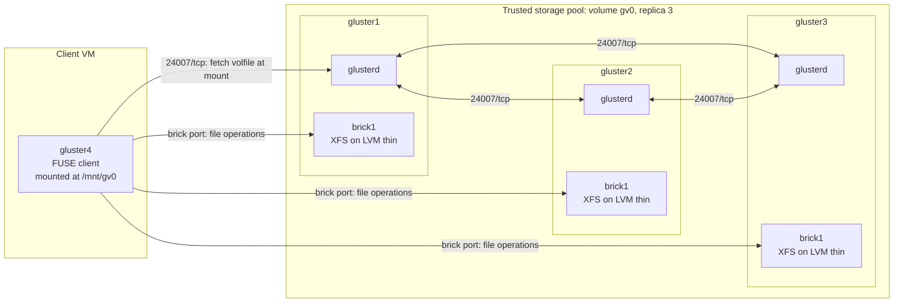
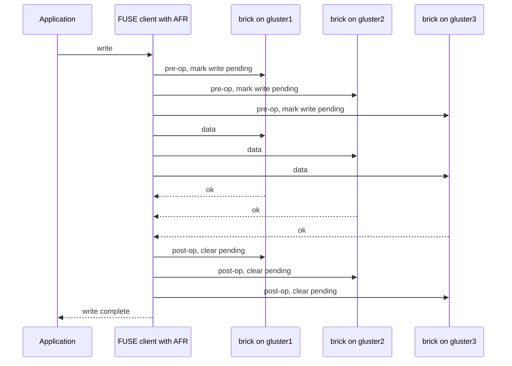
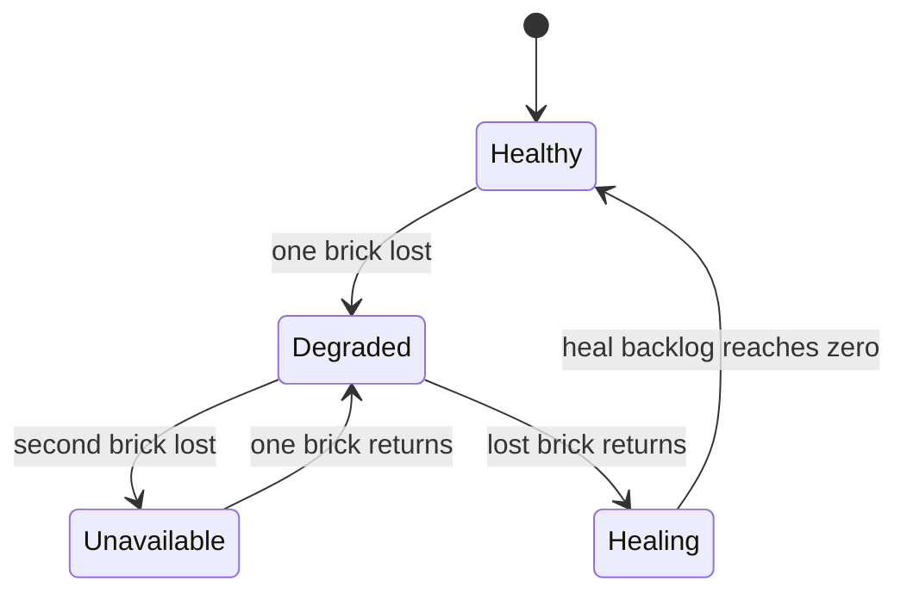
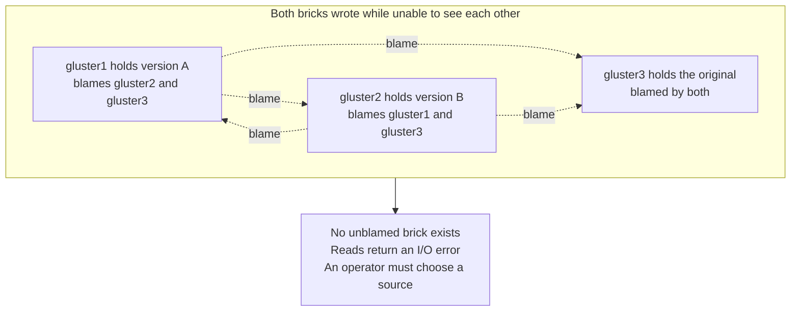

# Architecture

This document explains the components of the lab and how data and control traffic move between them. The diagrams are Mermaid source and render on GitHub.

## Components

| Component | Runs on | Responsibility |
|---|---|---|
| `glusterd` | gluster1, gluster2, gluster3 | Management daemon. Holds pool and volume configuration, starts brick processes, answers CLI commands. Listens on 24007/tcp. |
| `glusterfsd` (brick process) | gluster1, gluster2, gluster3 | One per brick. Serves file operations for that brick on its own port. |
| Brick | gluster1, gluster2, gluster3 | A directory on a local XFS filesystem: `/data/glusterfs/brick1/vol`. |
| Self-heal daemon | gluster1, gluster2, gluster3 | Finds files that a brick missed and copies them from a good replica. |
| FUSE client | gluster4 | Mounts `gv0`. Fetches the volume description, then talks to every brick directly and performs the replication itself. |

## Topology

Control plane: `glusterd` to `glusterd` on 24007/tcp, and the client's one-time volfile fetch.
Data plane: client directly to each brick process. Brick ports are allocated per brick starting at 49152 by default, which is why the predefined `glusterfs` firewalld service opens a range.

The client names `gluster1` at mount time, but that is only used to download the volfile. `backup-volfile-servers=gluster2:gluster3` lets the mount succeed if gluster1 is down at that moment.

## Write path

AFR (Automatic File Replication) is the replication layer inside the client. If a brick does not acknowledge, the pending marker for it is not cleared on the bricks that did. Those `trusted.afr.gv0-client-N` attributes are the self-heal to-do list. Brick index N follows the order in `gluster volume create`: client-0 is gluster1, client-1 is gluster2, client-2 is gluster3.

## Availability states observed

| State | Bricks reachable | Observed behaviour |
|---|---|---|
| Healthy | 3 of 3 | Normal writes, around 28 ms for small file creates in this lab |
| Degraded | 2 of 3 | Reads and writes continue. Graceful loss: no pause. Hard loss: a pause until `network.ping-timeout` expires. |
| Unavailable | 1 of 3 | Client log reports quorum not met. All lookups fail with `Transport endpoint is not connected` and new mounts fail. |
| Healing | 3 of 3, one stale | Surviving bricks list pending entries until the self-heal daemon copies them to the returned brick. |

Evidence for each row is in [failure-drills.md](failure-drills.md) and [evidence/](evidence).

## Split-brain

Split-brain means every replica is blamed by at least one other, so there is no trustworthy source.

Quorum on prevents this because the minority side refuses writes. The drill disables quorum and the self-heal options on purpose to create it.

## Trust boundaries and exposure

| Boundary | Traffic | Control in place | Not yet in place |
|---|---|---|---|
| Client to servers | Volfile fetch, file data | firewalld `glusterfs` service on servers | TLS, `auth.allow` |
| Server to server | Pool management, heal traffic | firewalld `glusterfs` service | TLS |
| Host to guests | SSH for administration | Lab network only | Hardening |
